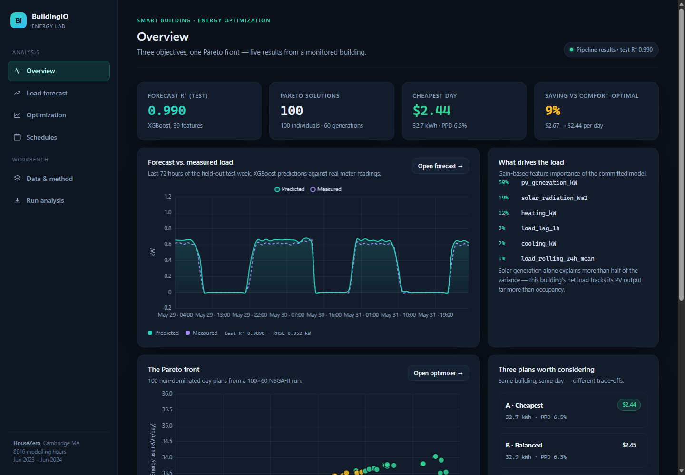
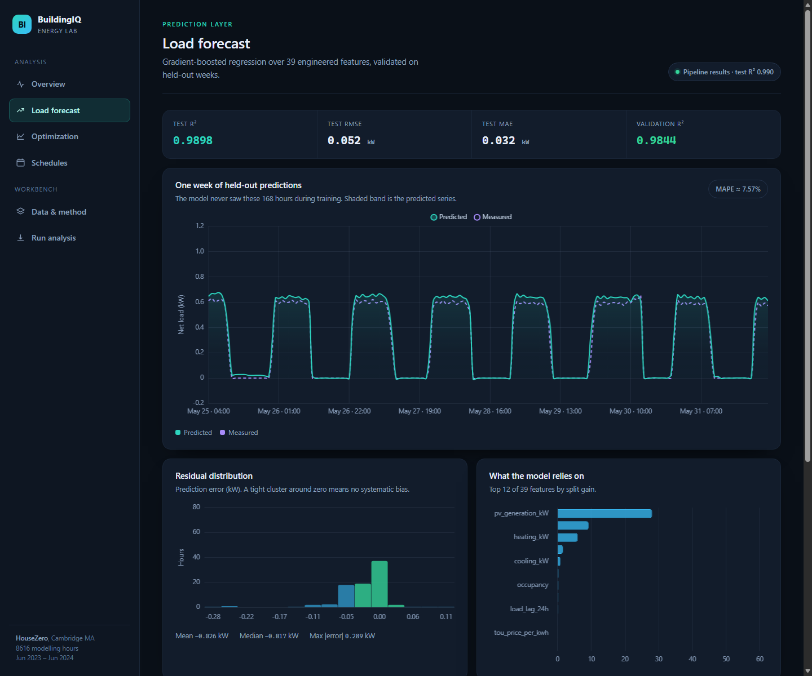
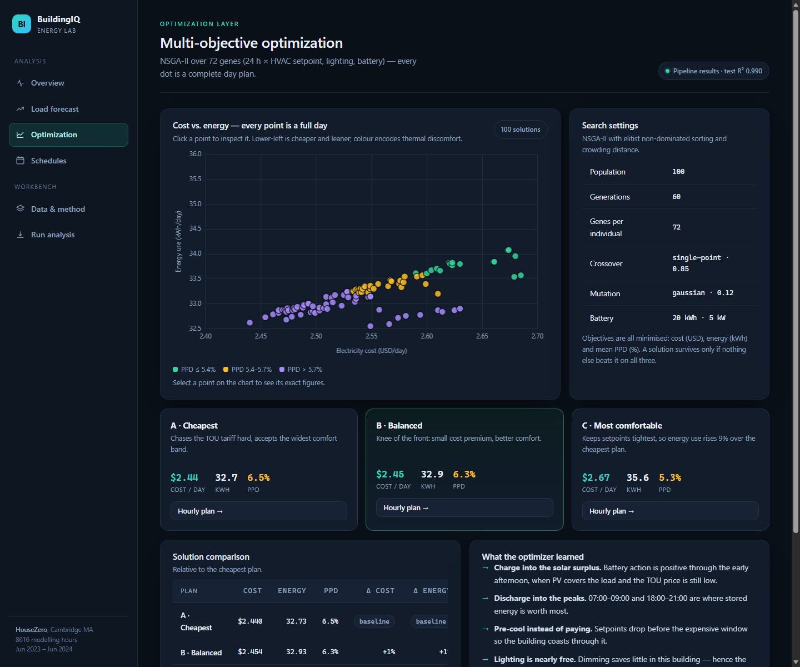
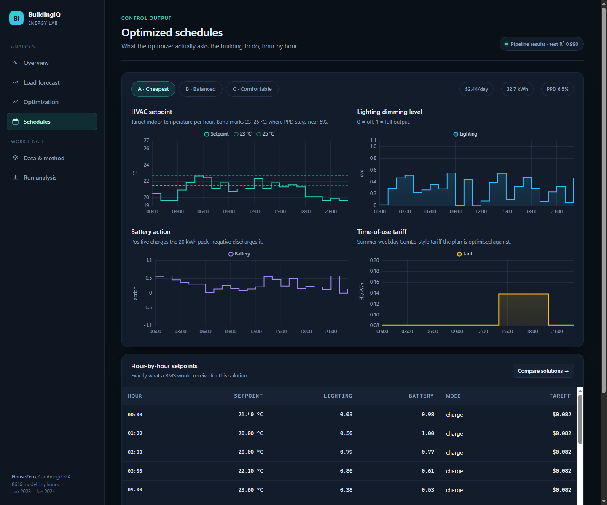
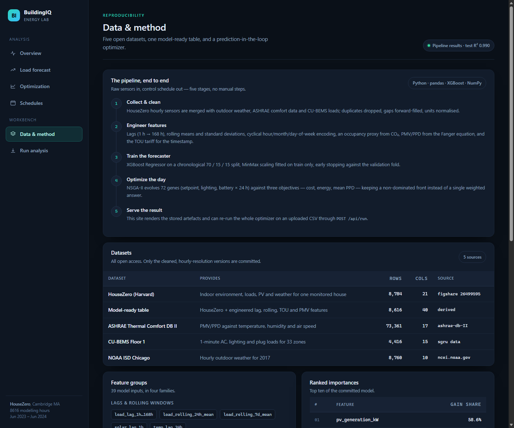
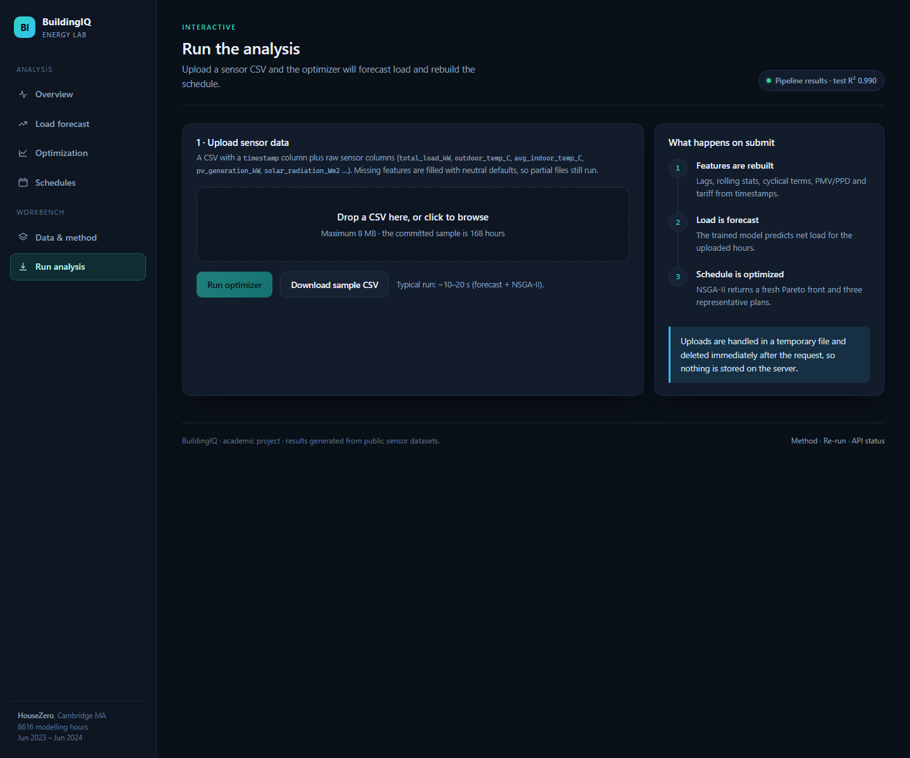
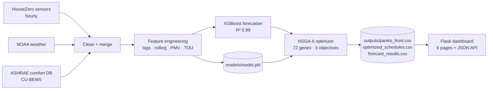

<div align="center">

# BuildingIQ — Smart Building Energy Optimization

**Forecast the load, then let a genetic algorithm find the cheapest, leanest and most comfortable way to run the building — all at once.**

[](https://www.python.org/)
[](https://flask.palletsprojects.com/)
[](https://xgboost.readthedocs.io/)
[](#model-performance)
[](LICENSE)



</div>

---

## Table of contents

- [What this project does](#what-this-project-does)
- [Results at a glance](#results-at-a-glance)
- [Screenshots](#screenshots)
- [How it works](#how-it-works)
- [Repository structure](#repository-structure)
- [Datasets](#datasets)
- [Model performance](#model-performance)
- [Optimizer](#optimizer)
- [Quick start](#quick-start)
- [Web app routes and API](#web-app-routes-and-api)
- [Regenerating the results](#regenerating-the-results)
- [Design notes](#design-notes)
- [Limitations](#limitations)
- [Roadmap](#roadmap)
- [License](#license)

---

## What this project does

Most building controllers optimize one thing: electricity cost. This project optimizes **three
objectives at the same time** for a real, sensor-instrumented building:

| Objective | Direction | What it means |
| --- | --- | --- |
| Electricity cost | minimise | shift load to off-peak hours, discharge the battery into peaks |
| Energy consumption | minimise | reduce waste, self-consume solar instead of importing |
| Thermal comfort | minimise (as PPD) | keep occupants inside the PMV −0.5 … +0.5 comfort band |

Instead of collapsing those into one weighted score, a **NSGA-II genetic algorithm** returns a
**Pareto front** — a set of day-plans where nothing can be improved in one objective without
losing in another. The building operator then picks a point on that curve.

The optimizer is fed by a **machine-learning load forecast**, not an assumed load profile, so the
schedules it produces are based on what the building is actually about to consume.

**The three pieces**

1. **Prediction** — XGBoost regressor over 39 engineered features (lags, rolling statistics,
   cyclical time, weather, solar, PV, PMV/PPD, TOU tariff).
2. **Optimization** — NSGA-II over 72 genes = 24 hours × (HVAC setpoint, lighting level, battery action).
3. **Presentation** — a Flask dashboard with six pages that turns the stored artefacts into
   charts, schedules and downloadable results.

---

## Results at a glance

| Metric | Value |
| --- | --- |
| Forecast R² (held-out test week) | **0.9898** |
| Forecast RMSE / MAE | 0.052 kW / 0.032 kW |
| MAPE (hours with \|load\| > 0.1 kW) | 7.57 % |
| Pareto-optimal day plans found | **100** (population 100 × 60 generations) |
| Cheapest plan (A) | $2.44 / day · 32.7 kWh · PPD 6.5 % |
| Balanced plan (B) | $2.45 / day · 32.9 kWh · PPD 6.3 % |
| Most comfortable plan (C) | $2.67 / day · 35.6 kWh · PPD 5.3 % |
| Cost spread across the front | **9 %** ($2.67 → $2.44) |
| Strongest load driver | `pv_generation_kW` (59 % of gain) |

> Every number above is read from `outputs/results_summary.json`, which is regenerated by the
> scripts in this repo — nothing is hard-coded into the pages.

---

## Screenshots

| Overview | Load forecast |
| --- | --- |
|  |  |
| **Multi-objective optimization** | **Optimized schedules** |
|  |  |
| **Data & method** | **Run the analysis** |
|  |  |

---

## How it works



### Stage by stage

1. **Collect & clean** — HouseZero hourly rows joined with outdoor weather, comfort and CU-BEMS
   loads; duplicates dropped, gaps forward-filled, units normalised, saved to `data/cleaned/`.
2. **Engineer features** — 8 load lags (1 h → 168 h), rolling means/std, cyclical encodings for
   hour/month/weekday, an occupancy proxy from CO₂, PMV/PPD via the Fanger equation, and the TOU
   tariff for every timestamp.
3. **Train** — chronological 70 / 15 / 15 split, MinMax scaling fitted on train only, early
   stopping against the validation fold. Saved as a single `joblib` payload with its feature order.
4. **Optimize** — NSGA-II evolves a population of 24-hour control chromosomes, simulating cost,
   energy and mean PPD for each, keeping a non-dominated front with crowding-distance diversity.
5. **Serve** — Flask reads the artefacts once, renders them server-side, and exposes the same data
   as JSON. The `/run` page uploads a CSV and re-executes stages 2–4 live.

---

## Repository structure

```
SmartBuilding/
├── app.py                    Flask app: 6 pages, JSON API, live optimizer endpoint
├── run_optimization.py       forecast + NSGA-II; run() is shared by the CLI and the web app
├── train_model.py            retrains the XGBoost model and rewrites feature importances
├── requirements.txt
├── data/
│   ├── cleaned/              modelling tables (19 MB): master_table, train/val/test_scaled,
│   │                         scaler_params, housezero / ashrae_comfort / cubems / noaa
│   └── sample/
│       ├── sample_sensor_data.csv    168 raw hours — the file the /run page uses
│       └── sample_*                  an older demo run kept for comparison
├── models/model.pkl          trained XGBoost + feature order + target scaler
├── outputs/
│   ├── results_summary.json  every headline number on the site
│   ├── forecast_results.csv  actual vs predicted, test week (168 rows)
│   ├── pareto_front.csv      100 non-dominated day plans
│   ├── optimized_schedules.csv  3 × 24 h schedules
│   ├── feature_importance.csv   gain share per feature
│   └── full_results_dashboard.png  9-panel static figure
├── static/css/main.css       design system (dark console theme)
├── static/js/charts.js       Chart.js wrappers (line, bar, histogram, Pareto scatter)
├── static/img/               favicon + social preview
├── templates/                base, overview, forecast, optimization, schedules, pipeline, run, 404
├── docs/
│   ├── HANDOFF.md            original research handoff (deep dive on method + rationale)
│   └── screenshots/
└── raw/                      downloaded dataset archives — git-ignored (435 MB)
```

---

## Datasets

| Dataset | Rows used | Provides | Source |
| --- | --- | --- | --- |
| **HouseZero** (Harvard) | 8,784 | indoor temp/RH/CO₂, loads, PV, weather — main training data | [figshare 26499595](https://doi.org/10.6084/m9.figshare.26499595) |
| **ASHRAE Thermal Comfort DB II** | 73,361 | PMV/PPD against temperature, humidity, air speed | [ashrae-db-II](https://github.com/CenterForTheBuiltEnvironment/ashrae-db-II) |
| **CU-BEMS Floor 1** | 4,416 | AC, lighting and plug loads across 33 zones | [sgru data](https://sgrudata.github.io/) |
| **NOAA ISD Chicago** | 8,760 | hourly outdoor weather for 2017 | [ncei.noaa.gov](https://www.ncei.noaa.gov/) |
| **ASHRAE GEP III** | 11.8 M (raw) | multi-building electricity for future generalisation work | [Kaggle](https://www.kaggle.com/c/ashrae-energy-prediction) |

Only the cleaned, hourly-resolution tables are committed. The multi-hundred-megabyte raw archives
in `raw/` are git-ignored — download them from the links above if you want to rebuild from scratch.

---

## Model performance

| Split | RMSE (kW) | MAE (kW) | R² |
| --- | --- | --- | --- |
| Validation | 0.1052 | 0.0604 | 0.9844 |
| **Test** | **0.0524** | **0.0316** | **0.9898** |

XGBoost, 800 trees, depth 7, learning rate 0.05, early stopping at 30 rounds.

**Top features by gain:** `pv_generation_kW` 59 % · `solar_radiation_Wm2` 19 % · `heating_kW` 12 %
· `load_lag_1h` 3 % · `cooling_kW` 2 %.

**Why XGBoost over an LSTM:** with lag features pre-computed, gradient boosting matches recurrent
models on tabular time series, trains in seconds without a GPU, and its importances are directly
readable — which matters when the point is to explain *why* a building consumes what it does.

**One quirk worth knowing:** plain MAPE is meaningless here because the building's night-time draw
approaches zero (a 0.01 kW error becomes a 100 % error). The reported 7.57 % is computed only over
hours with |load| > 0.1 kW, and that choice is recorded in `results_summary.json`.

---

## Optimizer

| Parameter | Value |
| --- | --- |
| Algorithm | NSGA-II style (elitist non-dominated sort + crowding distance) |
| Population | 100 |
| Generations | 60 |
| Chromosome | 72 genes = 24 h × (setpoint, lighting, battery) |
| Setpoint range | 20 – 26 °C |
| Lighting range | 0 – 1 (dimming) |
| Battery action | −1 (discharge) … +1 (charge) |
| Battery plant | 20 kWh capacity, 5 kW charge/discharge, 92 % efficiency |
| Crossover | single-point, rate 0.85 |
| Mutation | Gaussian, rate 0.12 per gene, σ 0.15 |
| Selection | binary tournament |

**Objectives (all minimised):**

```
cost      = Σ net_grid_kW × tou_price(hour, month, is_weekend)      over 24 h
energy    = Σ net_grid_kW                                            over 24 h
discomfort = mean PPD(setpoint)                                      over 24 h
```

**What the front shows:** the cheapest plans accept a slightly wider comfort band; the
comfort-optimal plan spends about 9 % more money and 9 % more energy to keep PPD near 5 %. The
battery policy that falls out of this is sensible without being told: charge into the afternoon
solar surplus, discharge into the morning and evening peaks.

---

## Quick start

```bash
# 1. dependencies
python -m venv .venv
.venv\Scripts\activate          # Windows
source .venv/bin/activate       # macOS / Linux
pip install -r requirements.txt

# 2. run the dashboard (uses the committed model + outputs)
python app.py                   # http://127.0.0.1:5000
```

No configuration is required — the model, scaler and results are all committed. To use another
port, set `PORT` (and optionally `HOST`) before starting:

```bash
set PORT=5055        # Windows cmd
PORT=5055 python app.py
```

### Re-run the optimizer from the command line

```bash
python run_optimization.py --input data/sample/sample_sensor_data.csv
```

It prints the Pareto size and the three plans, and writes the full payload to
`outputs/last_run.json`.

---

## Web app routes and API

| Route | Purpose |
| --- | --- |
| `/` | Overview: KPIs, 72-hour forecast, Pareto preview, the three plans |
| `/forecast` | Full test week, residual histogram, feature importances, model card |
| `/optimization` | Interactive Pareto scatter, search settings, solution comparison |
| `/schedules` | Hour-by-hour setpoints, lighting and battery for each plan (deep-linkable: `#A_cheapest`) |
| `/pipeline` | Datasets, feature groups, pipeline stages, limitations, reproduce steps |
| `/run` | Upload a sensor CSV and run forecast + optimization in the browser |

| API | Returns |
| --- | --- |
| `GET /api/summary` | the contents of `results_summary.json` |
| `GET /api/forecast` | test-week series + residual histogram |
| `GET /api/pareto` | every Pareto point (cost, energy, PPD) |
| `GET /api/schedules` | 3 × 24 h schedules with tariff |
| `GET /api/sample` | the sample CSV as a download |
| `POST /api/run` | multipart `file=<csv>` → fresh forecast, Pareto front and schedules |
| `GET /health` | `{"status": "ok", "model": true}` |

`POST /api/run` accepts any CSV with a `timestamp` column plus raw sensor columns; missing
features are filled with sensible defaults (column means) so a partial export still runs. Uploads
are written to a temporary file and deleted in a `finally` block.

---

## Regenerating the results

```bash
python train_model.py                                            # -> models/model.pkl + feature_importance.csv
python run_optimization.py --input data/sample/sample_sensor_data.csv
```

The dashboard reads whatever is in `outputs/`, so replacing those files updates every page and
keeps the site consistent with the model. After retraining, refresh `results_summary.json` as well
(it drives the headline tiles) — the numbers in this README should be updated at the same time.

---

## Design notes

The original prototype was one 600-line HTML file with inline CSS and JS that stacked every chart
on a single scrolling page. It has been split into six task-focused pages sharing one design system:

- **One purpose per page** — analysis, forecast, optimization, schedules, method, run.
- **Design tokens** — colours, radii and spacing live in `:root`; no per-page stylesheets.
- **Charts separated from data** — `static/js/charts.js` wraps Chart.js; templates pass data via
  `{{ ... | tojson }}`, so no chart code is duplicated between pages.
- **Server-side rendering** with a small JSON API for the interactive page only.
- **Accessibility** — skip link, semantic landmarks, `aria-current` on navigation, `aria-label` on
  every canvas, visible focus rings, and a print stylesheet.
- **No build step** — no bundler, no npm, no CDN fonts; the only external asset is Chart.js.

---

## Limitations

1. **One building.** Everything is trained on HouseZero; cross-building validation is still open.
2. **Simplified plant.** The simulator has no thermal mass, humidity or equipment ramp rates, so
   schedules are a starting point for a controller, not a supervisory command.
3. **Static tariff.** A real-time price signal would change the battery policy hour by hour.
4. **Fixed comfort assumptions.** PMV uses met = 1.2 and clo = 0.5 for everyone.
5. **No demand-response objective.** Grid curtailment signals are not modelled yet.
6. **Demo-scale serving.** The Flask dev server is single-process; use a WSGI server behind a
   reverse proxy for anything real.

---

## Roadmap

- [ ] Train on ASHRAE GEP III buildings and cross-validate across sites
- [ ] Hyperparameter search (Optuna) to push R² past 0.995
- [ ] Battery state-of-charge tracking with degradation cost in the objective
- [ ] Compare against an LSTM forecaster on identical features
- [ ] Add CO₂-driven ventilation as a fourth control variable
- [ ] Demand-charge and grid-signal aware optimization
- [ ] Export schedules as BMS-ready BACnet points

---

## License

Code is released under the [MIT License](LICENSE). The datasets keep their own licences
(CC-BY for HouseZero and ASHRAE Comfort DB, competition licence for ASHRAE GEP III) — see the end
of the LICENSE file for details.

<div align="center">
<sub>Built with Flask, XGBoost and NumPy — results generated from public building-sensor data.</sub>
</div>
